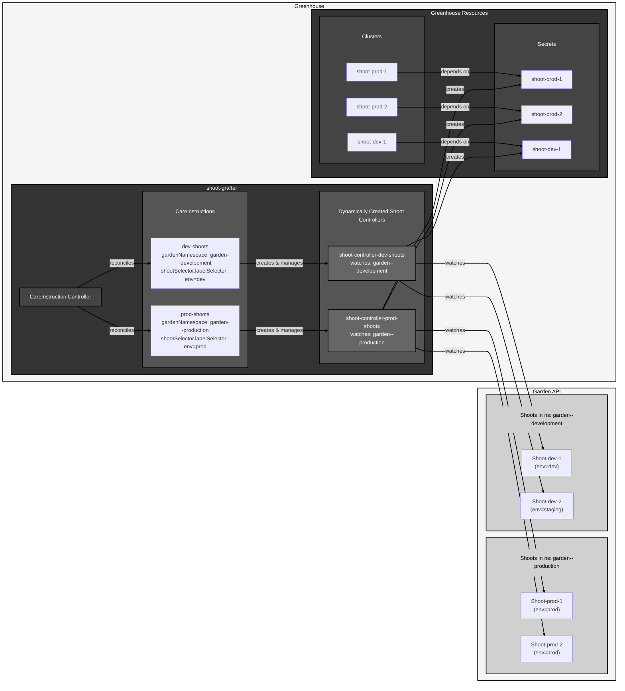

## Controllers

### CareInstruction Controller

The `CareInstruction` is the primary Custom Resource Definition (CRD) that configures how shoot-grafter operates. Each CareInstruction:

- Defines which Garden cluster to monitor (via kubeconfig secret or Greenhouse Cluster reference)
- Specifies which namespace to watch for Shoots
- Declares label selectors and CEL expressions to filter which Shoots to onboard
- Configures label propagation and additional metadata
- Manages the lifecycle of dynamically created Shoot controllers

### Shoot Controller

For each CareInstruction, a dedicated Shoot controller is dynamically created and runs in its own manager. This controller:

- Watches Shoot resources in the specified Garden cluster namespace
- Extracts cluster connection details (API server URL, CA certificate)
- Creates or updates corresponding Secret resources with OIDC configuration
- Generates Greenhouse Cluster resources with appropriate labels
- Optionally configures OIDC authentication on Shoot clusters for Greenhouse access. Also see respective [Greenhouse docs](https://cloudoperators.github.io/greenhouse/docs/user-guides/cluster/oidc_connectivity/) and [Gardener docs](https://gardener.cloud/docs/guides/administer-shoots/oidc-login/#configure-the-shoot-cluster)
- Optionally configures RBAC on the Shoot cluster for Greenhouse access
- Cleans up Greenhouse clusters when the corresponding Gardener Shoot is removed

> **Auth ConfigMap labeling & watch**: When `authenticationConfigMapName` is set, the shoot controller:
> - Labels the referenced Greenhouse ConfigMap with `shoot-grafter.cloudoperators.dev/auth-configmap: "true"` so the CareInstruction controller can watch it. When the data changes, all CareInstructions referencing that ConfigMap are re-enqueued.
> - Creates or overwrites a ConfigMap in the Garden cluster with the Greenhouse content verbatim. That Garden CM is labeled `shoot-grafter.cloudoperators.dev/careinstruction: <careInstructionName>` to mark ownership and to scope the CM-change watch to Shoots managed by the same CareInstruction.
> - Labels each configured Shoot with `shoot-grafter.cloudoperators.dev/careinstruction: <careInstructionName>` so that Garden CM changes trigger reconciliation of only the relevant Shoots.
